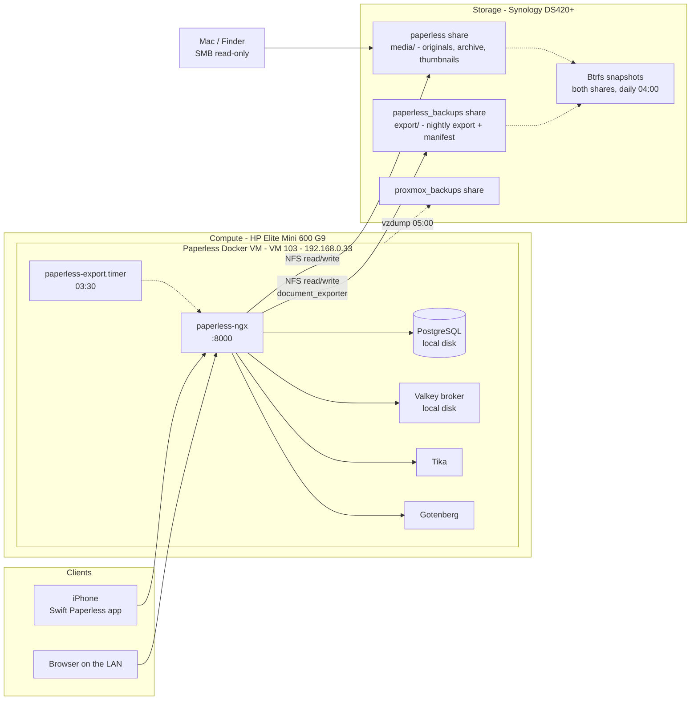

# Paperless-ngx (Document Management)

[Paperless-ngx](https://docs.paperless-ngx.com/) turns scans and digital documents into a searchable archive. It runs OCR on every document, stores a searchable PDF next to the original, and suggests tags, correspondents and document types from what it has learned. Documents arrive through the web UI, the iPhone app, or later by email.

**This is the first service in the homelab whose data can't be replaced** (tax documents, contracts, certificates). The design is driven by that: the documents themselves live on the NAS, in plain, readable files, so they stay reachable even if Proxmox is down.

**Status**: Planned (2026-10-11). Nothing deployed yet. VM ID, IP, share names and the DSM account are confirmed; see [Decision Log](#decision-log). Upstream version at planning time: **3.3.0** (released 2026-10-06).

---

## Architecture Plan



What lives where:

| Data | Contents | Location | Why |
| --- | --- | --- | --- |
| **Media** | Original files, OCR'd archive PDFs, thumbnails | **NAS**, `paperless` share, `media/` subfolder, over NFS | Survives a Proxmox failure; SHR redundancy; readable in Finder thanks to the filename format |
| **PostgreSQL** | Tags, correspondents, document types, notes, users, permissions | VM disk (`/docker/appdata/paperless/pgdata`) | Databases corrupt over NFS. Copied to the NAS every night by the export |
| **Data** | Full-text search index, auto-matching model, logs (later: AI vector index) | VM disk (`/docker/appdata/paperless/data`) | Rebuilt from the database and documents if lost; faster locally |
| **Export** | Every document + `manifest.json` (all metadata) + `metadata.json` (Paperless version) | **NAS**, `paperless_backups` share, `export/` subfolder | Restores into a fresh Paperless on any host with `document_importer` |

### If Proxmox goes down

- **Paperless is unavailable**, but **every document is still on the NAS**: open the `paperless` share in Finder and browse `media/documents/originals/2026/<Correspondent>/<Title>.pdf`.
- **Metadata** (tags, notes) is at most 24 hours old in `paperless_backups/export/manifest.json`.
- **Rebuild anywhere**: a new Docker host + the same `PAPERLESS_TAG` + `document_importer` on the export (see [Restore Procedures](#restore-procedures)).

---

## Deployment Specs

- **Host Platform**: Proxmox VE on HP Elite Mini 600 G9.
- **VM**: **VM 103**, hostname **`paperless`**, Debian **13 (trixie)**. It's a dedicated VM for one service, so it follows the one-guest-per-service rule in [services/proxmox.md](../proxmox.md#hosted-workloads). The four containers are parts of Paperless, not separate services.
- **Sizing**: 2 vCPU (type `host`), **4 GB RAM** (balloon device on, no minimum, no swap), **32 GB** disk on `vm-disks` (VirtIO SCSI single, Discard + IO thread + SSD emulation), machine `q35`, SeaBIOS, VirtIO NIC on `vmbr0`, QEMU guest agent, **Start at boot** on.
  - CPU: OCR uses all cores while it processes a document and is idle otherwise. With 2 vCPU, Paperless runs one task at a time with 2 OCR threads (its defaults). Raise the core count live for the initial backlog if it feels slow.
  - RAM: Paperless ~1 GB during OCR, Tika (Java) ~0.5–1 GB, Gotenberg (Chromium) ~0.3–0.5 GB, PostgreSQL and Valkey ~0.2 GB. Revisit if AI with local (`huggingface`) embeddings is enabled.
  - Disk: OS ~3 GB, container images ~4 GB, database and index well under 1 GB at the expected volume. The documents themselves are on the NAS.
- **Provisioning Method**: same recipe as VM 101: Debian `genericcloud` image + cloud-init, configured in the Proxmox GUI. See [services/arr-stack/README.md](../arr-stack/README.md#deployment-specs) for the step-by-step; the cloud image is already on `nas-images`. Differences: VM ID `103`, name `paperless`, IP `192.168.0.33/24`, 4 GB RAM.
- **Access**: SSH as `admin` with key only. `admin` is in the `docker` group (same as VM 101).
- **Network**: static IP **`192.168.0.33/24`**, gateway `192.168.0.1`, DNS `192.168.0.1` — next address in the `.30`–`.99` service range, see [hardware/networking.md](../../hardware/networking.md#static-ip-assignments). (This ID and IP were first proposed for Tailscale, which now has TBD values.)
- **Docker**: Docker Engine + Compose plugin from [Docker's official apt repository](https://docs.docker.com/engine/install/debian/), same as VM 101.
- **NFS mounts** (`nfs-common`), in `/etc/fstab`:
  ```text
  192.168.0.10:/volume1/paperless          /mnt/paperless          nfs  defaults,_netdev  0  0
  192.168.0.10:/volume1/paperless_backups  /mnt/paperless_backups  nfs  defaults,_netdev  0  0
  ```
  Each line mounts one Synology share at boot. `_netdev` makes the mount wait for the network. `defaults` includes `hard`: if the NAS stops answering, Paperless waits instead of getting I/O errors, which protects the files from half-written states. A drop-in ([systemd/docker-wait-for-nfs.conf](systemd/docker-wait-for-nfs.conf)) keeps Docker from starting until both mounts are up.
- **Subfolders, not share roots**: Paperless uses `media/` and `export/` *inside* the shares. DSM creates its own hidden folders at share roots (`#recycle`, `@eaDir`, `#snapshot`); keeping Paperless one level down means its sanity checker doesn't report them as stray files, and `document_exporter --delete` can never touch them.
- **Stack location**: `/opt/paperless/` (owned by `admin`): [docker-compose.yml](docker-compose.yml) and `.env` (from [.env.example](.env.example)).
- **Container images**: official images only — `ghcr.io/paperless-ngx/paperless-ngx`, `postgres`, `valkey/valkey`, `gotenberg/gotenberg`, `apache/tika`. **Every tag is pinned** in `.env`; see [Updating image tags](#updating-image-tags).
- **Backups**: see [Backup Requirements](#backup-requirements).

### Network Ports

| Port | Protocol | Service | Exposure |
| --- | --- | --- | --- |
| 8000 | TCP | Paperless web UI + REST API (used by the iPhone app) | LAN; remotely through Tailscale once deployed |
| 5432 | TCP | PostgreSQL | Docker network only — not published |
| 6379 | TCP | Valkey | Docker network only — not published |
| 3000 | TCP | Gotenberg | Docker network only — not published |
| 9998 | TCP | Tika | Docker network only — not published |

Outbound: `ghcr.io` / Docker Hub for image pulls, Debian mirrors. Later, IMAP (993) if mail rules are set up.

### Paperless Settings (in [docker-compose.yml](docker-compose.yml))

| Setting | Value | Why |
| --- | --- | --- |
| `PAPERLESS_OCR_LANGUAGE` | `fra+deu+eng` | French mainly, German and English occasionally. All three ship with the image. Multiple languages cost more CPU per document, which doesn't matter at this volume; drop `deu` or `eng` if OCR feels slow |
| `PAPERLESS_FILENAME_FORMAT` | `{{ created_year }}/{{ correspondent }}/{{ title }}` | Readable files on the NAS, e.g. `2026/Swisscom/Facture octobre.pdf` |
| `PAPERLESS_FILENAME_FORMAT_REMOVE_NONE` | `true` | A document without correspondent goes to `2026/<title>.pdf` instead of a `none/` folder |
| `PAPERLESS_TIKA_ENABLED` + endpoints | on | Office files and `.eml` emails |
| `USERMAP_UID` / `USERMAP_GID` | `paperless` DSM user's UID / `100` | Files on the NAS are owned by a real DSM account |
| `PAPERLESS_DATE_ORDER` | not set (default `DMY`) | Matches Swiss date formats |
| `PAPERLESS_URL` | `http://192.168.0.33:8000` | Required for logins and form posts (CSRF) from that address |

**Don't rename or move files in the `paperless` share by hand.** Paperless remembers each file's path and reports moved files as missing. That's why your own DSM account gets **read-only** access to it.

---

## Storage Plan

### Synology shares

| Share | Contents | Data checksum | Recycle bin | Snapshots |
| --- | --- | --- | --- | --- |
| `paperless` | `media/` — Paperless media folder | On (Btrfs, set at creation) | Off — snapshots replace it | Daily 04:00, keep 30 |
| `paperless_backups` | `export/` — `document_exporter` target | On | Off | Daily 04:00, keep 30 |

Expected footprint: under 10 GB of documents now, growing slowly. The export roughly doubles that, and snapshots add only changed blocks: **~25 GB in total**, small against the 1.4 TB free on Volume 1 (see the capacity warning in [hardware/storage.md](../../hardware/storage.md#storage-pool--volume)).

### NFS exports

| Share | Client | Privilege | Squash | Security |
| --- | --- | --- | --- | --- |
| `paperless` | `192.168.0.33` only | Read/Write | **No mapping** | `sys` |
| `paperless_backups` | `192.168.0.33` only | Read/Write | **No mapping** | `sys` |

### File ownership: dedicated `paperless` DSM user

Same pattern as the `arr` user (see [services/arr-stack/README.md](../arr-stack/README.md#file-ownership-dedicated-arr-dsm-user)):

- DSM user **`paperless`**, group `users` (GID `100`): Read/Write on `paperless` and `paperless_backups` only, No access on every other share, all DSM applications denied. DSM assigns the UID at creation (`id paperless` over SSH); it goes into `.env` as `PAPERLESS_UID`.
- With **No mapping**, NFS passes UIDs through unchanged. At start-up, the Paperless container (running as root) fixes ownership of its folders to `USERMAP_UID:USERMAP_GID`, then runs as that user. Everything it writes on the NAS is owned by `paperless`.
- **Permissions come from DSM ACLs, not mode bits**: as on the `tv` share, `ls` shows `777`, but only accounts with a DSM privilege can write. On the VM, use `sudo -u paperless` (a local mirror account with the same UID) to work on the shares.
- **Your own DSM account**: **Read-only** on `paperless`, so you can browse the documents over SMB in Finder. No access needed on `paperless_backups` for daily use (DSM admins can always reach it).

---

## Ingestion

| Method | Status | Notes |
| --- | --- | --- |
| **iPhone — [Swift Paperless](https://github.com/paulgessinger/swift-paperless)** | Primary | Scan with the camera (document edge detection), upload through the API, browse and search. Server `http://192.168.0.33:8000`. Works away from home through Tailscale once it's deployed |
| Web UI upload (drag and drop) | Available | For PDFs and Office files already on the Mac |
| Email (IMAP mail rules) | Later | Pull attachments or whole emails from a dedicated folder. Requires storing a mailbox (app) password in Paperless — see [Security Considerations](#security-considerations) |
| Consume folder / scanner | Not used | No scanner. If one is added later, see [Future Work](#future-work) |

To check at step 10: whether Swift Paperless accepts a plain `http://` server address. If the app requires HTTPS, a reverse proxy with TLS becomes a prerequisite for the phone (see [Future Work](#future-work)).

### Organizing documents

- **Paper is kept**, so use **ASN (archive serial number) stickers**: number the paper copy (pre-printed barcode labels or handwritten), and Paperless reads the barcode or stores the number. Any digital document then points to its paper original, and the binder can simply be ordered by number.
- Start with a small set of **document types** (Facture, Contrat, Fiche de salaire, Impôts, Assurance, …) and **correspondents**; let auto-matching learn from your corrections over the first few dozen documents.
- **Workflows** can assign tags, owners or permissions at upload time (e.g. everything uploaded by the second user is owned by them).

---

## AI Features (later, not enabled)

Paperless-ngx 3.x has built-in, optional AI: suggested titles, tags, correspondents, document types and dates, a "similar documents" view and a document chat. It's off by default and doesn't replace the built-in auto-matching. Enabling it later is a configuration change, not a redesign:

| Setting | Purpose |
| --- | --- |
| `PAPERLESS_AI_ENABLED=true` | Master switch |
| `PAPERLESS_AI_LLM_BACKEND` | `ollama` (local) or `openai-like` (any OpenAI-compatible API) |
| `PAPERLESS_AI_LLM_ENDPOINT` / `PAPERLESS_AI_LLM_MODEL` | Where the model runs and which one |
| `PAPERLESS_AI_LLM_EMBEDDING_BACKEND` | `huggingface` (runs inside this VM, model downloaded into the data folder), `ollama` or `openai-like` — needed for chat and similar documents |

The settings can also be changed in the UI (Settings → Application Configuration). Options and trade-offs for *where the model runs* (local Ollama guest on CPU, cloud API, future GPU host) are recorded in [Future Work](#future-work). **A cloud backend sends document contents to that provider**, which runs against the reason for self-hosting these documents.

---

## Backup Requirements

| What | Method | Target | Verified |
| --- | --- | --- | --- |
| **Documents** (originals, archive PDFs, thumbnails) | Stored directly on the NAS (SHR) + daily Btrfs snapshots (30 days) | `paperless` share | — |
| **All data, portable** (documents + full metadata + Paperless version) | `document_exporter --delete`, nightly 03:30 via [systemd timer](systemd/paperless-export.timer) | `paperless_backups/export/` + daily snapshots (30 days) | — |
| **Whole VM** (OS, Docker, database, index, `.env`) | Shared nightly `vzdump` job, 05:00, `stop` mode (DB cleanly shut down) | `nas-backups` → `proxmox_backups` share (see [services/proxmox.md](../proxmox.md#backup-jobs)) | — |
| `docker-compose.yml`, `.env.example`, systemd units | Version-controlled in this repo | Git | — |
| `.env` secrets | Password manager (and inside `vzdump`) | — | — |
| Offsite copy | **Not yet** — see below | — | — |

Notes:

- **Why both the export and `vzdump`**: `vzdump` restores this exact VM in minutes. The export is the app-level backup recommended in [docs/storage-strategy.md](../../docs/storage-strategy.md#upgrading-to-app-level-backups): it doesn't depend on Proxmox and restores into a fresh install anywhere.
- **The media share isn't in `vzdump`**: NFS mounts aren't VM disks, so the archives stay small (OS + database).
- **`--delete` + snapshots**: the export mirrors the live archive (a document deleted in Paperless disappears from the export the next night), while snapshots keep 30 days of earlier states. Paperless's own trash adds another 30 days before a deleted document is really removed.
- **Version matters for restores**: an export can only be imported reliably into the **same Paperless version**. `export/metadata.json` records it; use that version as `PAPERLESS_TAG` when restoring.
- **Remaining gap — everything is on one NAS**: media, export, snapshots and `vzdump` all live on the DS420+. A NAS failure (or a fire, or theft) would lose the digital archive. The paper copies cover that for now. Next step: **Hyper Backup of `paperless_backups` offsite, with client-side encryption** — ~10 GB, cheap. Shared gap with every other service, see [docs/storage-strategy.md](../../docs/storage-strategy.md#baseline-proxmox-vzdump).

### Restore Procedures

| Scenario | Procedure |
| --- | --- |
| Document deleted by mistake | Paperless trash (30 days); after that, the file from a `paperless` snapshot (DSM → Snapshot Replication → restore single file), re-uploaded |
| VM broken, NAS fine | Restore VM 103 from `vzdump`. The media share is untouched and is remounted automatically |
| Proxmox host lost | New Docker host (any Linux): install the same `PAPERLESS_TAG`, point `MEDIA` at an **empty** folder, run `document_importer ../export` against a copy of `paperless_backups/export/`. The importer must run on an empty installation |
| Bad update / corrupted database | Roll back the VM from `vzdump`, or restore the export into a fresh instance |

---

## Dependencies

- **Synology DS420+** reachable over NFS. This is a hard runtime dependency: if the NAS is down or rebooting (DSM updates), Paperless can't open documents and Docker won't start at boot (see [Known Limitations](#known-limitations)).
- **Docker** (official repo) and image registries `ghcr.io` / Docker Hub for updates.
- **Swift Paperless** app on the iPhone.
- **Tailscale** (planned, see [services/tailscale/README.md](../tailscale/README.md)) for access away from home. Without it, Paperless is home-only, which is acceptable at the start.
- **Hyper Backup destination** (future) for the offsite copy.

---

## Security Considerations

- **Sensitive data**: IDs, contracts, tax and medical documents. The guiding rule is **no public exposure**: no port forward, no public hostname. Remote access only through the planned Tailscale.
- **Authentication**: one account per person, no shared logins. **Enable 2FA (TOTP)** on the admin account in the user profile right after the first login. The second user, if added, gets a normal account (not superuser) and sees only what is shared with them (per-document owners and permissions).
- **Plain HTTP on the LAN**: the password and documents cross the home network unencrypted. Acceptable short-term on a trusted LAN; over Tailscale the traffic is WireGuard-encrypted anyway. HTTPS via a reverse proxy is listed in [Future Work](#future-work).
- **Secrets stay out of the repo**: `PAPERLESS_SECRET_KEY` and `POSTGRES_PASSWORD` live only in `.env` on the VM and in the password manager. PostgreSQL, Valkey, Tika and Gotenberg are not published outside the Docker network.
- **NAS least privilege**: the `paperless` DSM user can only reach its two shares; the NFS exports accept only `192.168.0.33`. With *No mapping*, root on the VM is root on these shares — another reason for SSH key only and a single-purpose VM.
- **Protection against the VM itself**: a compromised VM could delete or encrypt the files it can write. Btrfs snapshots are taken by DSM and are not reachable over NFS, so they survive that. DSM 7.2's immutable snapshots would also protect against a compromised DSM admin account (see [Future Work](#future-work)).
- **Gotenberg** is started with JavaScript disabled and external content blocked (upstream flags), so converting an email doesn't load tracking pixels or run scripts.
- **Encryption at rest**: Volume 1 is not encrypted, so documents and exports are stored in clear on the NAS disks. Accepted for a home NAS; the offsite copy must be encrypted (Hyper Backup client-side encryption).
- **Export and mail passwords**: once IMAP mail accounts are configured, the export contains their passwords in plaintext unless `--passphrase` is added to the exporter. Add a passphrase at that point and keep it in the password manager — without it, an encrypted export can't be imported.
- **AI**: off. If enabled with a cloud backend, document contents leave the network.
- **VM hygiene**: SSH key only, unattended Debian security updates, Docker updated deliberately.

---

## Known Limitations

- **Paperless depends on the NAS at runtime.** During a NAS reboot, the NFS mounts block (`hard`) and the UI hangs until the NAS is back, then continues. If the VM boots while the NAS is down, Docker stays stopped by design; once the NAS is up: `sudo mount -a && sudo systemctl start docker`. Plan DSM updates outside the 03:30 export.
- **No HTTPS yet** (see Security Considerations).
- **Single NAS** for all copies until the offsite backup exists.
- **Exporter failures are silent**: there's no monitoring stack yet. Check now and then with `systemctl status paperless-export.service` and the date of `export/manifest.json`.

---

## Deployment Steps

Steps that change the NAS are marked **(confirm first)**, per [AGENTS.md Safety Rules](../../AGENTS.md#safety-rules). Commands run on the VM as `admin` unless stated otherwise.

0. ⬜ **Check the ID and IP are free**: on the Proxmox host, `qm list` and `pct list` (no guest 103), and `ping -c 2 192.168.0.33` (no answer). Two commands that list all VMs and containers, and a ping to make sure nothing already uses the address.
1. ⬜ **Synology — service account (confirm first)**: DSM user `paperless`, group `users`, applications all denied. Permissions are set in step 2 once the shares exist. Over SSH on the NAS, `id paperless` → note the UID for `.env`.
2. ⬜ **Synology — shares (confirm first)**: create `paperless` and `paperless_backups` on Volume 1: **Enable data checksum** on (only possible at creation), recycle bin **off**, not encrypted. Permissions: `paperless` user Read/Write on both; your own account **Read-only** on `paperless`; check the `users` group doesn't grant more.
3. ⬜ **Synology — NFS rules (confirm first)**: on each share → NFS Permissions → Create: client `192.168.0.33`, Read/Write, Squash **No mapping**, Security `sys`, other options default.
4. ⬜ **Synology — snapshots (confirm first)**: install *Snapshot Replication* from Package Center if needed. For both shares: schedule daily at 04:00, retention 30 snapshots, "Make snapshot visible" off.
5. ⬜ **Proxmox — VM 103**: build it with the VM 101 recipe (see [Deployment Specs](#deployment-specs)). Checks: SSH by key, guest agent shows the IP, unattended upgrades enabled, internet reachable. **Options → Start at boot: Yes.**
6. ⬜ **VM — Docker**: Docker's official apt repository, `docker run hello-world`, `docker compose version`, `sudo usermod -aG docker admin` (log out and back in).
7. ⬜ **VM — NFS mounts and local mirror account**:
   ```bash
   sudo apt install -y nfs-common
   sudo mkdir -p /mnt/paperless /mnt/paperless_backups
   # add the two fstab lines from Deployment Specs, then:
   sudo systemctl daemon-reload && sudo mount -a
   findmnt -t nfs,nfs4
   ```
   Installs the NFS client, creates the mount points, mounts both shares from `/etc/fstab`, and lists the active NFS mounts (both must appear).
   ```bash
   sudo useradd --system --uid <PAPERLESS_UID> --gid 100 --no-create-home --shell /usr/sbin/nologin paperless
   cd / && sudo -u paperless mkdir /mnt/paperless/media /mnt/paperless_backups/export
   sudo ls -ln /mnt/paperless /mnt/paperless_backups
   ```
   Creates a login-less local account with the same UID as the DSM user (so `sudo -u paperless` works and `ls -l` shows names), creates the two subfolders Paperless uses as that user, and checks they're owned by `<PAPERLESS_UID> 100`.
8. ⬜ **VM — Docker waits for NFS**:
   ```bash
   sudo mkdir -p /etc/systemd/system/docker.service.d
   sudo cp docker-wait-for-nfs.conf /etc/systemd/system/docker.service.d/wait-for-nfs.conf
   sudo systemctl daemon-reload
   systemctl show docker -p RequiresMountsFor
   ```
   Installs the [drop-in](systemd/docker-wait-for-nfs.conf) that makes Docker start only after both NFS mounts exist; the last command must list both mount points.
9. ⬜ **VM — stack**:
   ```bash
   sudo mkdir -p /opt/paperless /docker/appdata/paperless/{data,consume,pgdata,redis}
   sudo chown admin: /opt/paperless
   ```
   Creates the stack folder (owned by `admin`) and the local folders for database, broker, index and the unused consume folder. Copy [docker-compose.yml](docker-compose.yml) and [.env.example](.env.example) (as `.env`) into `/opt/paperless`, fill in `PAPERLESS_UID`, and generate the two secrets with the command in `.env.example` (store them in the password manager). Then:
   ```bash
   cd /opt/paperless && chmod 600 .env
   docker compose config --quiet && docker compose pull && docker compose up -d
   docker compose ps && docker compose logs -f webserver
   ```
   Restricts `.env` to `admin`, validates the compose file, downloads the pinned images (the real check that the tags exist), starts the stack, and follows the Paperless log until it says it's listening. All five services must be *Up*.
10. ⬜ **First login** at `http://192.168.0.33:8000`: create the superuser (password manager), **enable 2FA** in the profile, set the UI language. Install Swift Paperless and log in (check it accepts `http://`, see [Ingestion](#ingestion)).
11. ⬜ **Test documents** (5–10): a phone scan, a digital PDF, a `.docx` and an `.eml`. Check: OCR text is searchable (French accents correct), files appear in Finder under `paperless/media/documents/originals/<year>/<correspondent>/`, `sudo ls -ln` shows them owned by the `paperless` UID.
12. ⬜ **Backups**:
    - Install the [exporter service and timer](systemd/) into `/etc/systemd/system/`, `sudo systemctl daemon-reload && sudo systemctl enable --now paperless-export.timer`, then run it once by hand: `sudo systemctl start paperless-export.service` and check `journalctl -u paperless-export.service` and the files in `/mnt/paperless_backups/export/`. `systemctl list-timers paperless-export.timer` shows the next run.
    - Add VM 103 to the 05:00 `vzdump` job (Datacenter → Backup → Edit), run it once.
    - **Test-restore the export while there are only test documents** (see [Restore test](#restore-test)).
    - Test-restore the `vzdump` archive as a temporary VM **with its network device removed** (otherwise it would mount the NAS read/write next to the real VM), check the database and containers come up, destroy it.
13. ⬜ **Organize**: document types, correspondents, tags, the inbox tag, ASN numbering; delete the test documents (or keep them as examples).
14. ⬜ **Backlog import**: upload the existing documents in batches; correct suggestions as you go so auto-matching learns.
15. ⬜ **Docs**: mark Deployed in [services/README.md](../README.md); add VM 103 to [hardware/networking.md](../../hardware/networking.md#static-ip-assignments), to *Hosted Workloads* and the backup job table in [services/proxmox.md](../proxmox.md); move the two shares from planned to created in [hardware/storage.md](../../hardware/storage.md#primary-shared-folders) with the NFS rules and the `paperless` UID; record the results of steps 11–12 here.

### Restore test

Runs a second, throwaway Paperless on the same VM (port 8001, all local folders, no NAS access) and imports the export into it:

```bash
sudo mkdir -p /opt/paperless-restore/{appdata,media} && sudo chown -R admin: /opt/paperless-restore
cd /opt/paperless-restore
cp /opt/paperless/docker-compose.yml /opt/paperless/.env .
sudo cp -a /mnt/paperless_backups/export ./export
```

Creates a scratch folder, copies the compose file and `.env`, and copies the current export to local disk (small while there are only test documents). Edit the copied `.env`: `APPDATA=/opt/paperless-restore/appdata`, `MEDIA=/opt/paperless-restore/media`, `EXPORT=/opt/paperless-restore/export`, `PAPERLESS_PORT=8001`, `PAPERLESS_URL=http://192.168.0.33:8001`. Then:

```bash
docker compose -p paperless-restore run --rm webserver document_importer ../export
docker compose -p paperless-restore up -d
```

`-p paperless-restore` gives the copy its own containers, network and database, separate from the live `paperless` project (this is why the compose file sets no fixed container or network names). The first line starts the copy's database and imports everything (users included) into the empty instance; the second starts it on port 8001. Log in at `http://192.168.0.33:8001` with your normal account and check documents, tags and full-text search. Clean up:

```bash
docker compose -p paperless-restore down
sudo rm -rf /opt/paperless-restore
```

Stops and removes the copy's containers, then deletes the scratch folder (check the path before running it — only `/opt/paperless-restore`). Repeat once a year, or after a major Paperless upgrade.

### Updating image tags

- **Paperless**: read the [release notes](https://github.com/paperless-ngx/paperless-ngx/releases), run the export by hand (`sudo systemctl start paperless-export.service`), change `PAPERLESS_TAG` in `.env`, then `docker compose pull && docker compose up -d`. Database migrations run automatically at start. Update the tag in [.env.example](.env.example) too.
- **Tika, Gotenberg, Valkey**: stateless or cache-only; update the tags freely (upstream's compose file shows the versions they test with).
- **PostgreSQL**: minor versions come with the `18` tag on `docker compose pull`. A **major** upgrade (e.g. 18 → 19) needs an export, a fresh database and an import — never just change the tag.

### Rollback

Nothing outside VM 103 and the two shares changes. To undo: `docker compose down` and destroy VM 103 in Proxmox. **The shares and their documents stay**; deleting them, the NFS rules or the `paperless` DSM user is a separate decision (ask first, per the Safety Rules).

---

## Decision Log

| # | Decision | Chosen | Alternatives considered |
| --- | --- | --- | --- |
| 1 | Hosting | **Dedicated Debian Docker VM** with upstream's official Compose setup: upstream-built images (including the dependencies for 3.x AI features), the VM mounts read/write NFS itself, and the same build recipe as VM 101 | Unprivileged LXC from community-scripts (lightest, matches TeslaMate, but bare-metal install that has to keep up with upstream, and read/write NFS needs the host-mount + UID-shift workaround); Synology Container Manager (no NFS, but the DS420+ CPU is slow for OCR and it goes against "Synology for storage"); adding it to VM 101 (rejected: that VM is not a general-purpose Docker host) |
| 2 | Where documents live | **Media on the NAS over NFS, database and index local, nightly export to a second share, Btrfs snapshots on both** — documents survive a Proxmox failure and are readable without Paperless | Everything local + nightly export (faster, independent of the NAS, but up to 24 h of uploads only on the VM); media on NAS without filename format (safe, but files named `0000123.pdf`) |
| 3 | Filename format | **`{{ created_year }}/{{ correspondent }}/{{ title }}`**, empty placeholders removed | Paperless default (`0000123.pdf`); document type first (`Factures/2026/…`); storage paths per document type (more flexible, set in the UI) |
| 4 | Database | **PostgreSQL** (upstream's recommendation, part of the official Compose variant) | SQLite (one container less, but upstream recommends Postgres and SQLite has more locking limits) |
| 5 | Office files and emails | **Tika + Gotenberg** from the start | PDFs and images only (saves ~1 GB RAM and two containers, but `.docx`/`.eml` would be rejected) |
| 6 | OCR languages | **`fra+deu+eng`** | `fra` only (fastest, worse on German/English documents); `fra+eng` and German later |
| 7 | Ingestion | **Swift Paperless (iPhone) + web UI**; email later | Consume folder on a NAS share (only needed for a scanner; NFS requires polling) |
| 8 | NFS ownership | **Dedicated `paperless` DSM user, No mapping** (same as `arr`) | Map all users to admin (simpler, but everything owned by `admin`) |
| 9 | Backups | **Export with `--delete` nightly at 03:30 + Btrfs snapshots (30 days) + `vzdump` (stop mode)** | Export without `--delete` (keeps deleted documents' files forever, but the export drifts from the live archive); zipped export (`--zip`, one file per night: easier to copy offsite, but no incremental updates and each night is a full copy) |
| 10 | Mount points | **Share roots mounted, Paperless uses `media/` and `export/` subfolders** | Paperless directly on the share roots (DSM's `#recycle`/`@eaDir` folders would show up as orphans, and `--delete` could touch them) |
| 11 | VM ID / IP | **VM 103, `192.168.0.33`** (Tailscale's proposed values moved to TBD) | VM 104 / `.34`, leaving 103/.33 to Tailscale |
| 12 | AI | **Deferred**; native 3.x AI enabled later by configuration | Paperless-AI / paperless-gpt add-ons (Paperless-AI is unmaintained since March 2026; native AI covers the same ground) |

---

## Future Work

- **Offsite backup**: Hyper Backup of `paperless_backups` (and ideally `proxmox_backups`) to an external drive or cloud target, with client-side encryption. The one remaining gap for irreplaceable data.
- **HTTPS**: a reverse proxy with a certificate, once local DNS (AdGuard Home) gives services names. Also removes any plain-HTTP limitation in the iPhone app.
- **Email ingestion**: IMAP mail rules on a dedicated mailbox folder (e.g. "Paperless"), then add `--passphrase` to the exporter.
- **Second user**: own account, owner-based permissions, a workflow that sets the owner on their uploads.
- **AI** — where the model runs:

  | Option | Advantages | Disadvantages |
  | --- | --- | --- |
  | Ollama in its own guest on Proxmox (CPU only) | Private; reusable by Home Assistant Assist | Slow (tens of seconds per suggestion on CPU); a small model needs 6–8 GB of RAM; the iGPU is used by Jellyfin and has limited Ollama support |
  | Cloud API (`openai-like`) | Fast, best quality, no local load | Document contents leave the network; per-use cost |
  | Future GPU host | Fast and private | New hardware, not justified yet |

- **Immutable snapshots** (DSM 7.2+) on both shares, so even a compromised DSM admin account can't delete them within the lock period.
- **Exporter monitoring**: a failure notification (e.g. `OnFailure=` to a notifier) once a monitoring/alerting service exists.
- **Scanner**: if one is added, a `paperless_consume` share mounted over NFS with `PAPERLESS_CONSUMER_POLLING_INTERVAL` set (NFS has no change notifications).
